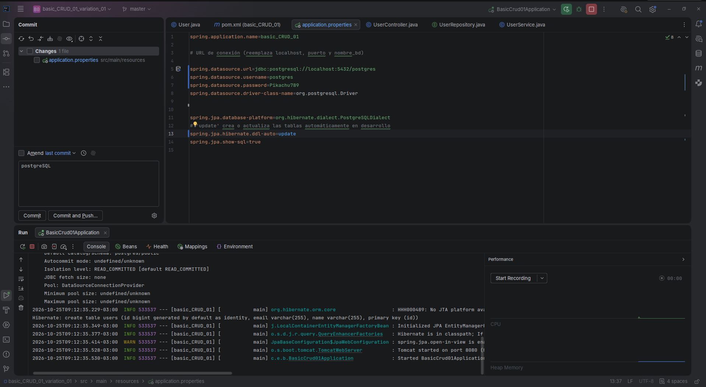
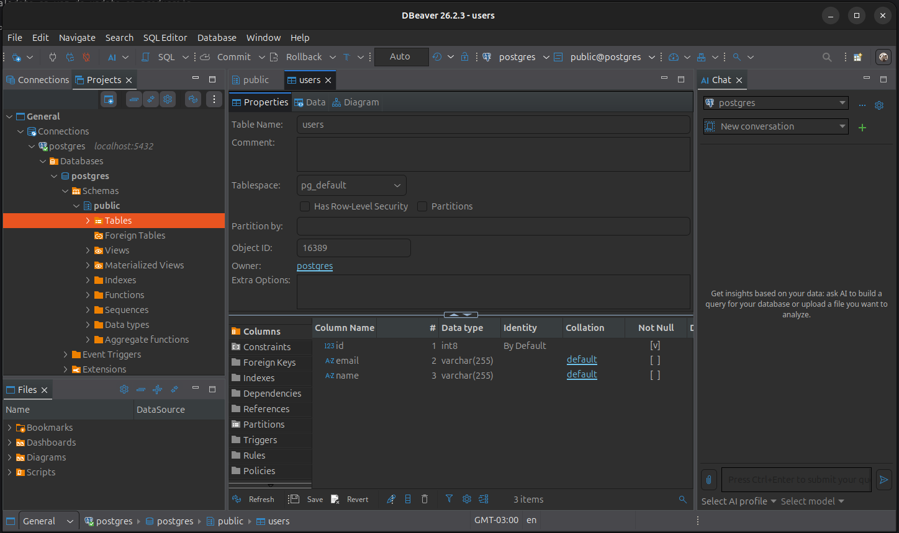

# basic_CRUD_01

API REST con Spring Boot 4.1.1 y Java 17 para gestión de usuarios con operaciones CRUD sobre PostgreSQL.

## Tecnologías

- Java 17
- Spring Boot 4.1.1
- Spring Data JPA
- PostgreSQL

## Endpoints

| Método | URL | Descripción |
|--------|-----|-------------|
| POST | `/api/users` | Crear usuario |
| GET | `/api/users` | Listar todos |
| GET | `/api/users/{id}` | Obtener por ID |
| PUT | `/api/users/{id}` | Actualizar usuario |
| DELETE | `/api/users/{id}` | Eliminar usuario |

## Modelo

```json
{
  "id": 1,
  "name": "string",
  "email": "string"
}
```

## Configuración

En `src/main/resources/application.properties`:

```properties
spring.datasource.url=jdbc:postgresql://localhost:5432/nombre_tu_base_datos
spring.datasource.username=tu_usuario
spring.datasource.password=tu_contraseña
```

## Ejecución

```bash
./mvnw spring-boot:run
```

## Capturas

### Spring Boot - Aplicación iniciada

En esta captura se puede ver la aplicación corriendo correctamente con Spring Boot 4.1.1, confirmando que el servidor levantó en el puerto 8080 y está listo para recibir peticiones.



### PostgreSQL - Base de datos funcionando

En esta captura se puede ver PostgreSQL funcionando correctamente con la tabla `users` creada, lista para persistir los datos gestionados por la API.


